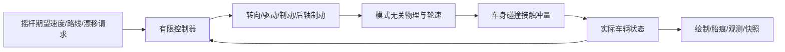

# v2 物理与网页接入

核心入口为 `src/vehicle/physics/index.ts`，网页通过 `src/vehicle/model.ts` 使用同一权威状态。`step`组合控制器与物理；`advancePhysical`只接受物理状态、执行器、物理参数、步长和路面。普通/漂移模式、期望速度、路线和目标侧滑不进入内核。

输入最大目标速度不构成真实速度上限。实际侧滑、前进分量和横摆不按模式限制，碰撞与既有失控在普通模式中继续生效。控制器的包络只限制执行器请求，机械执行器的真实行程与速率对两种策略一致。

场景用实际OBB足迹和包含旋转的扫掠找到接触时刻，接触点法向/摩擦冲量改变动量；无接触时返回与核心相同的结果。碰撞损失单独计入能量，不清轮胎、轮速或控制历史，不依据意图注入沿墙速度。完整重置是独立的生命周期操作。

四轮胎痕按所属轴的实际接地点侧向/纵向滑速与摩擦功产生，不以质心速度或质心侧滑角为必要条件，能表达纯旋转及动力空转。低速无滑直行不留痕；容量与寿命有界。

快照格式为 `vehicle-snapshot-2`，保存完整有效profile、模拟时间、轮速、力历史、加速度历史、控制历史和能量；恢复不按profile ID重新加载默认参数。拒绝旧版本、缺失状态和重复派生来源。自定义同ID参数与时间相关路面有精确续算测试。

验证面板显示控制请求、实际前轮、转向包络、饱和、轮速、滑移与能量；普通页面用“最高目标速度”和“漂移辅助”表达期望。`/?test=1`仅在开发模式允许注入完整物理初态；普通输入不具有状态修改权限。

检查入口：`npm run typecheck`、`npx vitest run`、`npm run build`、`npm run test:e2e`、`npm run physics:benchmark`、`npm run physics:audit`、`npm run validation:replay`。执行结果分别记录在两个变更的acceptance，v2证据进入独立的vehicle-physics-2目录，不覆盖v1。

真实手机驾驶尚未执行，核心及桌面浏览器通过不代表手机手感通过。两个变更保持进行中，不在本次自动归档或发布。
