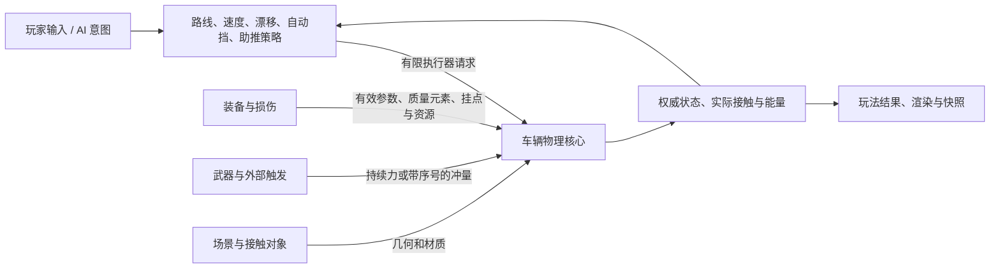

# 车辆架构 v5 实施与验收

日期：2026-11-02。对应车辆物理、装配、自动武器及战斗四个活动变更。功能与物理一致性检查通过；高负载战斗性能预算未通过，真机验收未执行。变更保持未归档。

## 实际分层

- `src/vehicle/control/` 选择路线、速度、漂移、自动挡和喷射请求，观测不提交控制历史。
- `src/vehicle/physics/` 负责发动机与变速箱执行、轮胎、刚体、质量属性、静态扫掠、车辆双刚体接触、供电预算、外部作用及能量。
- `assembly-drive.ts` 以 1/120 秒外步、两个 1/240 秒子步接线；每个子步控制历史只推进一次。
- `loadout/compose.ts` 将部件、安装高度、健康与属性映射为有效参数；无驾驶权限、无动力、无供给分别处理。
- 玩家与敌车使用同一控制和物理核心。碰撞与后坐力写回现有状态，保留燃料、电量、挡位、轮速、横摆、冷却和控制历史。

## 关键修正与回归覆盖

独立手刹实际使用 handbrakeForce；恢复系数与低速反弹阈值参与接触求解；静止穿透只修正位置。车辆间使用 OBB 接触交换双方动量和横摆，接触耗散只记一次。

质量属性计算包含三维重心及部件自身惯量，运行仍为平面刚体。喷射器按实例保存位置、方向、持续时间和冷却；拆装只迁移相应状态。

每步电池输出依次分配给常驻设备、喷射器和武器。限流缩短实际喷射工作时间，不降低额定耗能以保留全推力。武器从零开始有限充能，开火只消费已充入的能量和弹药；高射速允许在同一步多次充放电，累计不超过共享预算。充能、外力去重历史与敌车运行状态均可序列化续算。

基础车型 aero 和 loadSensitivity 保留历史零默认，另有非零配置行为测试；这不等于已完成实车参数标定。状态保持冻结及只读派生 getter，并复用已冻结子对象以减少运行分配。

## 自动验证

本机 Node.js v25.9.0 / Windows x64；浏览器回归使用 Playwright Chromium 项目。

| 检查 | 结果 |
| --- | --- |
| 全量 Vitest | 33 文件、248 项通过；最终战斗热路径调整后补跑 50 项相关回归通过 |
| Playwright | 最终完整运行 45 项通过 |
| TypeScript / Vite | `npm run build` 通过 |
| OpenSpec 严格校验 | 11 个活动变更通过 |
| 核心基准与审计 | 十车型、七组对比、19,200 轨迹点通过；包含稳定性、恢复、漂移、数值与能量核对 |
| 实际装配矩阵 | 14 个配置、378 个工况全部通过 |
| 固定时钟回放 | 十车型 30/60/120 FPS 状态差为零 |
| 历史证据 | 驾驶、核心旧版本、装配 v3/v4、营地及 UI 原证据内容保持不变 |

浏览器侧滑测试改为在同一状态样本判断侧滑与胎痕，避免顺序等待导致后续样本已经退出侧滑；原阈值保留。所有新增浏览器证据写入 v5 目录，避免覆盖历史截图。

核心 runId：`4e653f6a2a4a`；源码 SHA-256：`4e653f6a2a4af870c1fbb4fdac5074c07a4dfd6756bfdc15676de34a7e2d246a`。哈希包含物理、独立控制模块及 simulation 编排。装配 SHA-256：`18047b22d2f9aefa243ace916361917c7988d9df96192d8441c3b68aa334db9d`。

证据：[核心审计](evidence/vehicle-physics-5/core/audit-4e653f6a2a4a.json)、[装配矩阵](evidence/vehicle-physics-5/assembly-matrix.json)、[网页回放](evidence/vehicle-physics-5/web/replay-summary.json)、[浏览器 UI](evidence/vehicle-physics-5/web/ui/)、[营地](evidence/vehicle-physics-5/web/hub/)。

## 性能与模型边界

[v5 战斗压力报告](evidence/vehicle-physics-5/desktop-roster-benchmark.json) 测量 128 个敌人（54 辆完整物理车辆）、2048 弹丸容量，预热 120 步、测量 600 步；实际峰值弹丸 2047，敌方发射 1491 次。p50=11.3302ms、p95=14.7717ms、max=18.0040ms，不含 Canvas 绘制和预填弹丸开销。

已优化重复车型复制、配对时实体查找、无冲量状态重建及不可变状态分配。**仍未达到 p95≤4ms 目标，满负载超过 120Hz 单步预算**；报告中 `withinEngineeringTarget:false`、`mobileVerified:false`。旧敌车轻量运动的 2.8166ms 报告保留为历史，不能作为当前版本性能验收。后续优化重点是批量车辆状态与接触候选管理，不能用直接设置敌车速度或忽略物理约束掩盖成本。

当前模型仍为平面刚体和等效前后轴；完整悬挂、侧倾翻车、倒挡、独立离合/差速器、动态燃油弹药质量和外挂碰撞形状尚未实现。动态实体接触仍为离散检查，未声明高速连续碰撞能力。真实手机驾驶、触控和战斗性能继续保留在原变更待办中。
