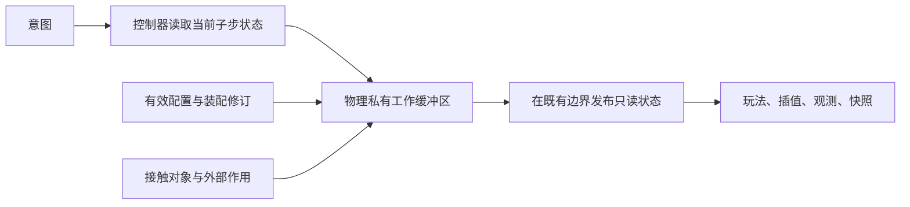

# Design

## Context

动机及范围见 [proposal.md](proposal.md)，验收合同见 [simulation-performance](specs/simulation-performance/spec.md)。本设计基于 2026-11-02 检查的 v5 工作区，规划起点提交为 `898932d`；实施开始时须记录完整提交号及实际源码哈希。

已确认的实现特征：

| 位置 | 观察 | 优化意义 |
| --- | --- | --- |
| `physics/state.ts` | 每次创建状态都会构建 getter、冻结对象；已复用冻结子对象，但仍有中间包装 | 继续减少中间创建，不能去掉公开只读与快照隔离 |
| `assembly-drive.ts` | 每外步两次控制／机械／轮胎推进，再包装完整状态 | 子步内部数据可以复用，控制历史提交次数和碰撞时刻必须保持 |
| `physics/physical.ts` | 两轴各执行 12 次接触迭代，迭代内重复求柔顺系数、矩阵行列式和制动容量 | 提前计算不变量，先保持数学表达式和更新顺序 |
| `physics/geometry.ts` | 一次生成轴、四轮、轮角、车身顶点、半径与包围盒 | 只取半径或轴位置的调用也承担完整几何开销 |
| `physics/vehicle-contact.ts` | 每对反复生成几何和投影数组，双方运动及账本分别包装 | 一次接触可出现约六次状态构造，适合合并中间计算 |
| `combat/world.ts` | 敌车按 ID 排序后逐对粗筛；54 辆车每步 1431 对 | 分散场景可减少候选；拥挤场景仍需降低每次实际接触成本 |
| `combat/spatial.ts` | 字符串网格键、实体按中心入格，每次查询新建数组 | 弹丸范围附加全场最大实体半径，大首领扩大无关候选范围 |
| `weapons/system.ts`、`render/combat.ts` | 挂点每步排序，目标全部排序后取第一；展示消费扫描历史队列 | 静态缓存、等价扫描和增量队列可减少附加工作 |

采样热点支持上述方向，但 profiler 的采样比例不是各模块独占耗时或预期加速比。历史压力场景在小范围放置高血量敌人，偏向拥挤极限；其计时不含人工补满弹丸、玩家车辆推进、场景扫掠和 Canvas 绘制。需要补充分层测量，不能用单个数字代表完整游戏。

当前 `openspec/specs/` 为空；车辆、装配、武器和战斗合同分别由 `build-vehicle-physics`、`add-assembly-physics`、`add-auto-weapons`、`add-combat-damage` 的活动 spec 定义。实施必须保留这些合同，新增能力只负责性能验收，不另建运动规则。

## Goals / Non-Goals

**Goals:**

- 明确性能成本、对象分配和负载增长关系，以可重复对照指导优化。
- 通过减少重复工作达到指定桌面参考压力工况 p95≤4ms，并保持原行为、时序和格式。
- 将内部运行缓冲区、有效配置、对外状态和显示数据的所有权定义清楚，供后续批量求解扩展。
- 性能结论覆盖正常和极端工况，原始证据可以复算；未达标不得被隐藏。

**Non-Goals:**

- 本轮不改变外步、子步、12 次求解迭代、物理公式、AI 意图更新频率、碰撞阶段、武器触发和随机消费顺序。
- 不删除能量账本、有限供电、后坐力、敌车轮胎或接触规则。
- 不引入新的物理模型、全项目 ECS 改造或必须的运行时依赖；不预先承诺 TypedArray／WASM 能达到某个加速倍数。
- 手机设备与产品帧率目标尚未冻结，本轮不取代原真机任务；桌面浏览器整帧结果用于暴露剩余瓶颈，不自动代表移动端通过。

## Decisions

### 1. 先固定对照，再逐阶段优化

新增版本化场景清单和性能运行器，保留现有 roster 场景作为参考压力工况，禁止修改其负载来换取达标。基线和候选执行顺序交替，使用同一硬件、运行时、依赖、场景、输入及参数；计时运行不并发执行其他测试、构建或 profiler。

每次性能进程预热 120 步、采样 600 步，五次独立进程；保留全部步耗时及每次 p50/p95/max，正式比较采用五次 p95 的中位数。参考工况要求该值≤4ms，且相对本机重跑的基线改善；其他冻结场景如中位 p95 恶化超过 5%，完整复测一次确认，确认回退则修复，不更改阈值。诊断计数与细粒度计时另跑，不能污染正式计时结论。

| 工况 | 内容 | 用途 |
| --- | --- | --- |
| 车辆规模 | 1／16／32／54／128 辆，分散与密集两类；无弹丸 | 控制、机械、轮胎和接触成本曲线；128 辆纯车仅用于扩展性诊断，不偷换 54 辆参考预算 |
| 混合参考压力 | 128 敌人、54 车、2048 弹丸容量，沿用种子 123 与原生成／补满规则 | 4ms 硬门槛及历史对照；报告实际峰值 2047 等观测值，不伪称 2048 全部活动 |
| 分散战斗 | 与参考相同实体与武器构成，冻结的分散初态及带时间戳输入 | 验证空间索引在正常布局下的收益 |
| 完整 PvE | 玩家驾驶、敌车、障碍物、时变输入、开火、损伤／脱落及展示 | 补足玩家推进与场景扫掠；使用产品现有固定步编排 |
| 浏览器整帧 | 固定 viewport／DPR 的上述 PvE，在真实墙钟下预热后连续记录至少 60 秒，重复三次 | 同时记录每帧模拟步数、CPU 模拟／Canvas 提交耗时、实际帧间隔、长任务和补步积压 |

阶段计时分为控制、机械供给、轮胎刚体、场景接触、动态接触、武器、空间查询／弹丸、展示事件及总步。父子范围分别报告，不能把嵌套耗时或各自 p95 相加。浏览器 Canvas 调用耗时不等于 GPU 完成时间，报告须说明；性能采样使用真实时钟，确定性回放另用固定调度。

相比只看整体 FPS，此方案能区分模拟、查询、垃圾回收与渲染瓶颈，也能识别“分散变快、拥挤仍慢”。

### 2. 物理内部复用，公开状态保持不可变

采用每个模拟实例私有的工作缓冲区，物理核心独占写权限。子步开始从当前状态读取，内部依次计算机械、轮胎、接触与账本；只在既有调用边界生成对外状态。保持原逻辑阶段：不能把原外步末尾碰撞提前到每个轮胎子步，也不能把中间所需控制观测推迟至外步结束。

优先使用固定形状的数值记录和可复用小数组，保留 JavaScript Number 精度。只有采样证明必要才扩大为 TypedArray 布局，浮点数据使用 Float64，不能通过 Float32 隐式改变精度。双缓冲仅限核心内部，调用方持有的旧状态必须始终有效；不能在第三步循环覆盖第一步已发布的数据。

保留 `physicalFrom/stateFrom` 等公开语义及自身只读派生 getter；减少它们在内部中间路径上的调用，不把公开 getter 改成可写字段。直接核心调用、装配路径、敌车和测试共用同一求解实现，不能维护两套演化的物理公式。缓冲区不跨世界共用、不进入快照，加载或重建世界时重新创建。

每次双车接触在局部变量中计算双方最终速度、横摆、能量差与损耗，再各自发布一次；静止无变化可复用既有不可变状态。合并包装不能改变碰撞顺序或账本归属。

### 3. 按生命周期缓存，按用途计算几何

| 数据 | 有效范围 | 失效条件 |
| --- | --- | --- |
| 质量／惯量倒数、轴距力臂、局部 OBB、保守半径、传动静态参数 | 已验证的有效参数版本 | 装配、健康、属性、车型或直接自定义配置变化 |
| 武器实例顺序、组件索引、有效静态属性 | 装配与修饰符版本 | 拆装、损伤、升级、限时修饰符到期、武器定义覆盖变化 |
| 朝向三角值、轴世界坐标、轴荷与路面观测 | 同一状态修订、模拟时间和采样器语义 | 子步推进、接触位置／姿态修正、参数变动；时变路面不可跨时刻复用 |
| 轮角、完整四轮显示几何、射界展示数据 | 当前渲染所需状态 | 插值姿态或显示参数变化 |

参数缓存以不可变有效配置／显式修订识别，不能仅按车型 ID 或可被原地修改的对象地址识别。公共入口继续支持相同 ID 的自定义完整参数；未编译外部输入先验证并复制，避免调用者修改原对象后命中旧缓存。

拆分半径、轴接触几何、碰撞几何和完整展示几何。控制和物理在同一子步初态下可共享观测；共享条件不成立时重新采样。查询半径由局部几何得到，不再生成四轮世界位置。接触修改位置后更新索引和世界几何，速度变化也要刷新依赖运动的观测。

替代方案是全局按车型名缓存，代价较低但会混淆不同装配，故不采用。

### 4. 提前计算迭代不变量

每个子步预计算两轴柔顺系数、系数矩阵行列式、抓地椭圆分母及前后制动容量；复用车身方向、力臂和质量惯量派生值。12 次迭代只保留依赖当前速度、横摆、轮速、累计冲量的计算与能量增量。

优先直接移动原表达式，避免同时改变加法顺序、除法与倒数乘法、近似三角函数或平方根实现。必须改变表达式时先通过冻结的差分与事件阈值测试，不以放宽容差接受分支变化。此阶段不使用提前停止、减少迭代或自适应步长。

### 5. 保持顺序与完整性的车辆接触优化

车辆空间候选生成和接触求解位于物理模块内，战斗只提供对象并消费结果。利用 AABB／保守边界和数字网格索引筛选候选，精确接触仍使用同一 OBB 算法。保持当前 `(较小实体 ID, 较大实体 ID)` 的字典序；无需处理的分离对可以跳过，但不能任意改变实际接触对的先后。

原双循环会在处理某一对时读取先前位置修正后的状态。候选优化因此不能只冻结步初候选：每次修正后更新两车空间位置，并补入字典序尚未经过的可能接触；已经经过的对不回头重算，以保留原一轮处理语义。候选拥挤、缓存容量不足或支持范围外时采用有界存储的朴素遍历回退，不能漏对或截断。该回退属于完整性策略，性能失败必须据实保留。

OBB 投影使用固定工作区，沿四个轴直接求最值，减少 map/filter 和临时向量。缓存的碰撞中心必须按原局部几何变换得到，不能默认等于偏置质心。接触点构造、摩擦、恢复系数和能量公式保持原语义。测试以原顺序朴素配对为参考，包含三车连锁挤压和深穿透。

### 6. 空间查询减小范围并安全复用缓冲区

战斗索引改为按实体包围范围覆盖的格子入格，弹丸用扫掠包围范围、爆炸用半径查询，随后执行现有精确判定。取消查询时附加全场最大半径的需求。网格键使用不会因负坐标、越界或位运算截断而冲突的数字坐标结构；超大物体可进入独立的大对象列表，避免占用无界格子。

查询结果用调用方提供的缓冲区与访问标记去重；缓冲区按调用深度或显式租用区分，命中触发爆炸时不得覆盖外层弹丸查询。访问代号溢出时清理后重启；实体槽复用依赖实体 ID／代次，不继承已死亡实体的去重状态。

命中仍按实际入射时刻再按实体 ID 排序；爆炸等对顺序敏感的查询需显式保持原参考实现的稳定顺序，不能把新网格遍历顺序直接带入玩法。目标选择维持原评分与同分 ID 规则；穿透、聚合载荷与已结算伤害记录保持不变。

### 7. 消除武器和展示的重复工作

把挂点排序、组件查找和有效静态属性放入配置编译阶段；动态资源、热量、锁定与目标每步继续更新。目标选择改为按相同评分和 ID 规则单次扫描，无需排序整个候选列表。

展示历史可改为固定容量环形存储，按消费者的最后序号增量读取；缓冲溢出保持当前容量与丢弃最旧展示的规则，伤害事件不能丢弃。保持现有去重、生命周期及暂停行为。渲染不再为每个敌人线性查找其武器表现，使用实体映射；仅显示用的几何可以按渲染帧计算，读写时机不得改变模拟输入或随机序列。

不在本轮将 AI 改为 10～20Hz，也不按画面可见性跳过武器结算。它们会改变目标决策和攻击时序，需要另立行为验收。

### 8. 验收与后续路线

行为测试与性能测量使用独立开关，正确性验证不纳入性能计时。基线阶段冻结有限场景的逐步状态和事件：沿用既有严格测试；新增浮点比较默认 `|a-b|≤1e-9+1e-9×max(|a|,|b|)`，既有更严格约束优先。事件序列、随机状态、目标、死亡、挡位、弹药及离散计数精确一致；同版本重复回放仍要求原确定性。边界阈值受微小数值变化影响时修正实现，不能事后放宽标准。

参考工况≤4ms 是本轮待验证目标，不是已知可保证结果。对应任务只有行为通过、正式五次测量达标且其他工况无确认回退才能勾选。未达标时记录剩余热点与阶段收益，不把“报告已生成”当作“性能已达标”。

后续路线按证据选择：AI 策略降频需定义采样延迟；休眠需涵盖输入、撞击、后坐力、外力、时变路面及装配变化的唤醒；Worker 需定义线程所有权、消息延迟和插值；WASM 需先确定稳定数值布局与边界传输成本。物理降频／降低迭代／远距简化会改变精度，必须另行版本化和验证。以上不计入本轮实现任务。

## Risks / Trade-offs

- 内部可变缓冲区破坏旧状态或多世界隔离 → 公开状态不复用写入；加入跨多个步、碰撞、快照恢复与两个世界交错推进测试。
- 参数或路面缓存陈旧 → 编译版本和状态修订分层；包含同 ID 不同参数、动态损伤、时变路面及接触修正的差分测试。
- 空间筛选改变接触／命中顺序 → 稳定排序、位置修正后更新候选，以朴素参考比较；无法证明完整时使用回退。
- 环形队列／查询复用造成事件遗漏 → 覆盖嵌套查询、多消费者、容量溢出和实体槽复用；展示丢弃与伤害结算隔离。
- 拥挤负载仍存在大量真实接触 → 同时优化每次接触成本并保留极限工况，不能宣称空间索引消除了所有二次复杂度。
- 计时噪声、JIT 和 profiler 扰动 → 独立进程、预热、串行配对测量、原始样本、诊断与正式结果分离。
- 缓存和缓冲增加常驻内存 → 记录堆、分配和多次创建／销毁世界后的保留对象；缓存跟随配置／世界生命周期释放，容量耗尽不能丢模拟工作。
- 当前优化不足以达到 4ms → 保留未通过项和新证据，后续方案经独立规划处理，不静默降低质量。

## Migration Plan

1. 先建立冻结基线、差分工具和运行清单，再记录当前实际机器的五次压力结果。
2. 依次实施 P0 参数与几何、P0 子步不变量、P0 工作缓冲、P1 车辆接触、P1 战斗查询、P2 武器与展示。每阶段独立测量并通过相关行为测试，确认无收益或有回退则撤回该阶段。
3. 公开接口和 v5 格式保持兼容，缓存从有效参数重建，不迁移历史缓存。若需要改变公开格式或物理行为，停止该扩展并单独提出变更。
4. 最终运行完整单元、浏览器、核心基准与审计、装配矩阵、帧率回放和性能矩阵。更新当前文档，证据写入本变更 `evidence/<源码哈希>/<场景>/<环境>/<运行编号>/`，保存基线引用及测量设置。
5. 实施期间以可独立回退的阶段组织代码；回退只撤销该阶段优化，保留基线与失败证据，不重置装备资源或覆盖旧档案。原真机任务继续保持其实际状态。

## Open Questions

- 网格单元尺寸、缓存容量及是否需要扩大 Float64Array 布局，由冻结矩阵中的候选数、分配和阶段耗时选择；候选完整性、预算与行为标准不因此改变。
- 尚无已连接目标手机，设备型号及热机条件在原真机任务中确定；当前只生成桌面与浏览器证据，不能据此推断手机容量。
